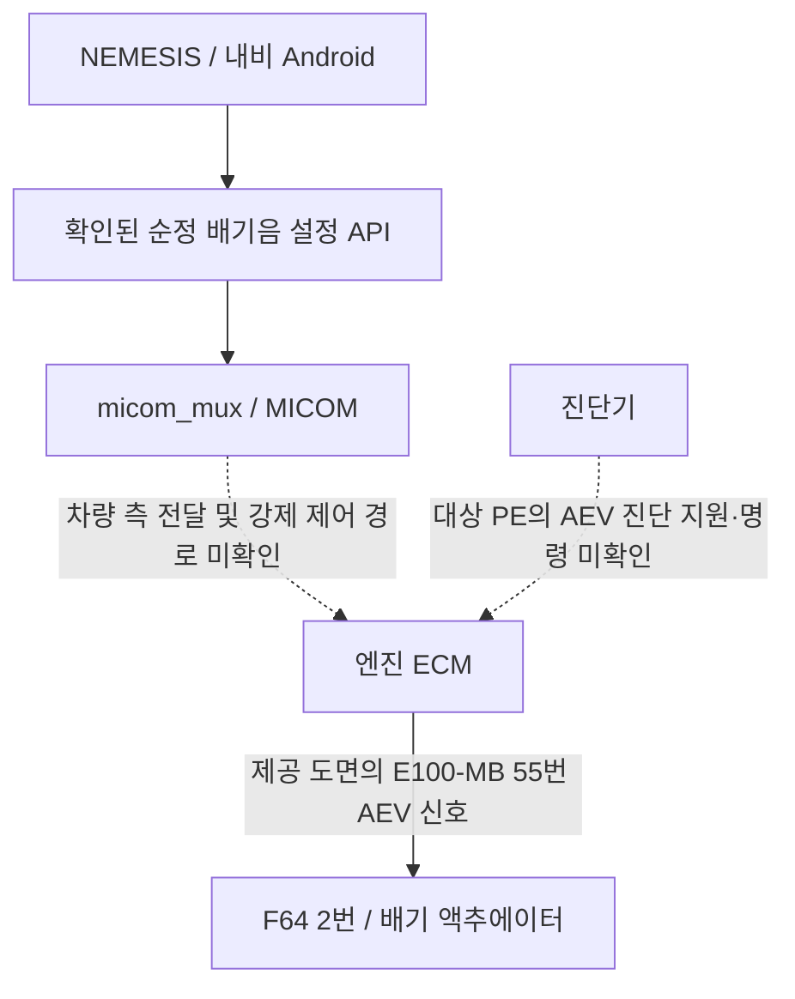

# CN7N PE AEV 회로·ECU 진단 제어 공개 자료 조사

조사일: 2026-11-19. 대상 내비 펌웨어: `CN7NPE.KOR.0000.V039.001.260902`.

**ECM과 배기 액추에이터 사이의 연결은 제공된 회로도에서 읽을 수 있습니다. 그러나 CN7N PE의 강제 열림·닫힘·제어 해제 진단 요청 바이트는 이번에 확인한 공개 자료에서 찾지 못했습니다.** 실차에 명령을 전송하거나 파형을 측정하지 않았습니다.

## 제공된 회로도 판독

사용자 제공 이미지의 제목은 `엔진 컨트롤 회로 (G4KH : THETA-II 2.0 T-GDi) (4)`, 페이지는 `SD313-4`입니다. 원본 이미지는 공개 저장소에 재배포하지 않습니다. 이미지에 연식·시장·PE 적용 정보가 없으므로, 아래 표는 **그 도면의 판독 결과**이며 대상 차량의 커넥터 사양을 별도로 검증한 결과는 아닙니다.

| 도면의 위치 | 읽히는 연결 | 의미와 한계 |
| --- | --- | --- |
| 액티브 배기 밸브 `F64`, 1번 | SENSOR2 10A 계통 → EF11 30번 → 전원 | 도면에는 다른 부하도 같은 전원 계통에 연결됨 |
| `F64`, 2번 | 신호 → EF11 7번 → ECM `E100-MB` 55번 `AEV 컨트롤` | 이 도면에서 배기 밸브를 제어하는 신호 연결 |
| `F64`, 3번 | 접지 → `GE02` | 전원·신호와 별도의 접지 |

이 도면에서 AEV는 연결된 부품명과 제조사의 정비 용어를 대조하면 **Active Exhaust Valve**로 해석됩니다. 현대차의 [25-EM-004H 정비 공지](https://static.nhtsa.gov/odi/tsbs/2025/MC-11019683-0001.pdf)도 CN7 N 뒤 머플러의 해당 부품을 Active Exhaust Valve라고 부릅니다.

`55`는 ECM 커넥터 단자 번호입니다. CAN ID, 진단 DID/RID 또는 Android API 번호가 아닙니다. 도면의 액추에이터 커넥터는 전원·신호·접지이며 CAN-H/CAN-L 한 쌍으로 그려져 있지 않습니다. 다만 이것으로 **ECM 상위에서 CAN 진단 요청을 받는지**까지 판단할 수는 없습니다. 단일 신호선이라는 사실만으로 PWM과 LIN도 구분할 수 없습니다.

## 공개 자료에서 확인한 것

### 1. 현대차 CN7 N 정비 공지: 밸브와 시동 초기화

[현대차 TSB 25-EM-004H, 2025-06, NHTSA 공개본](https://static.nhtsa.gov/odi/tsbs/2025/MC-11019683-0001.pdf)은 2022MY 이후 Elantra N(CN7 N)의 뒤 머플러 밸브 스프링 교환 자료입니다. 마지막 페이지에는 시동 시 자체 초기화 때문에 클릭음이나 마찰음이 발생할 수 있다고 설명합니다.

이는 시동 초기화 동작을 확인하는 근거입니다. **스프링 교환이나 자체 초기화가 진단 제어권 해제 명령이라는 뜻은 아닙니다.** 이 공지에는 강제 개폐의 CAN ID, DID/RID, 요청·응답 바이트가 없습니다. 미국 공지의 적용 범위를 한국 PE 차량의 ECU 진단 규격과 동일하게 취급하지 않습니다.

### 2. GIT GDS Smart: 강제 구동 기능은 있으나 AEV 차종 지원표는 아님

[GIT의 현대 GDS Smart 사용자 매뉴얼 안내](https://support.gitauto.com/hc/ko/articles/62300212690073)와 연결된 [강제구동 매뉴얼](https://gsup.gitauto.com/GDSN/GDSNif/support/usermanaul/HMC-CENTER-PA/ActuationTest.pdf)은 컨트롤 모듈을 통해 액추에이터를 구동·정지하고 센서데이터로 점검하는 기능을 설명합니다. [G-scan M 공식 매뉴얼, 인쇄 페이지 25](https://dncdn.gitauto.com/Support/Zendesk/Usermanual/G-scanM/G-scanM%20%EC%82%AC%EC%9A%A9%EC%9E%90%20%EB%A7%A4%EB%89%B4%EC%96%BC_20180810.pdf)은 지원 항목이 차량 컨트롤 시스템마다 다름을 명시합니다.

따라서 GDS에서 확인할 후보는 대상 차량의 **엔진 제어 시스템 내 AEV/액티브 배기 밸브 관련 강제 구동 항목**입니다. 그러나 확인한 문서는 CN7N PE에 해당 항목이 존재한다는 증거도, 세 가지 모드의 통신 규격도 아닙니다. 화면의 테스트 정지와 ECU의 순정 제어권 복귀를 같은 의미라고 가정하지 않습니다.

[카맨아이티 25C0 한국차 업데이트 공지](https://www.carmanit.com/27/?bmode=view&idx=169243896)에도 2025~2026 아반떼 N 엔진 제어 지원이 있지만, 해당 특수기능 목록에서 AEV 강제 개폐를 확인하지 못했습니다. 목록 부재만으로 다른 메뉴의 지원 여부까지 부정할 수는 없습니다.

### 3. XFORCE·KÜSTER: PWM 가능성을 좁히는 자료

[XFORCE BMC01 제품 설명](https://xforce.com.au/products/vw-amp-hyundai-oem-drive-mode-factory-control-3-pin-harness)은 일부 현대·기아 차량의 3핀 PWM 배기 신호를 VAREX Smartbox로 연결한다고 설명합니다. [제조사 설치 문서 v1.00, 2022-12-22](https://xforce.com.au/cdn/shop/files/bmc01installationguide.pdf)는 다음을 구분합니다.

- 인쇄 페이지 13: i30 N PDe, Kona N OS, Veloster N JS는 `Tested & Verified: Yes`.
- 인쇄 페이지 15: Elantra N CN7와 i30 N Sedan CN7는 목록에 있지만 **`Tested & Verified: No`**.

CN7N PE의 파형을 측정한 자료가 아니므로, 이 자료는 **PWM을 우선 확인할 단서**입니다. 주파수·전압·듀티와 개폐 방향은 확인되지 않았습니다. 또한 이 제품은 순정 배선 신호를 별도 하드웨어에서 읽는 방식이며, NEMESIS가 ECU에 강제 제어 명령을 보내는 구현을 제공하지 않습니다.

[KÜSTER의 액추에이터 제품 설명](https://produkte.kuester.net/en/products/flow-control-actuator)은 통신 방식으로 PWM 또는 LIN을 명시합니다. 같은 제조사나 유사한 외형이라는 이유만으로 특정 차량의 통신 방식·신호값을 확정할 수 없음을 보여줍니다. 대상 PE 차량의 실제 부품 제조사·부품번호는 아직 대조하지 못했습니다.

### 4. 외부 제어기의 OFF/CLOSE 의미도 구분 필요

[11MODE의 CN7 제품 설명](https://11mode.com/products/hyundai-elantra-avante-i30-n-sedan-cn7)은 ON을 열림 유지, OFF를 차량의 정상 제어로 복귀한다고 설명하며 **OFF가 강제 닫힘은 아니라고 명시**합니다. 본문 적용 연식도 2020~2023으로 되어 있습니다. 이미지의 CN7.5 표기만으로 한국 PE 호환성을 확정할 수 없습니다.

외부 제품의 존재는 하드웨어를 통한 개입 가능성의 단서입니다. ECU 진단 명령 공개나 사용자가 요청한 `열림 / 닫힘 / 순정 자동` 세 가지 제어의 검증으로 간주하지 않습니다.

### 보조 열람: 2022 CN7 N 정비 매뉴얼 공개 사본

[CN7-N Shop Manual v22.1121f](https://www.hexorcism.com/22CN7N/)의 `Engine Mechanical System → Intake And Exhaust System → Active Valve Assembly → Troubleshooting` 항목도 확인했습니다. 사이트는 현대차와 무관한 공개 사본이므로 버전·진위를 공식 최신 정비 자료와 대조해야 합니다. [해당 항목 주소](https://www.hexorcism.com/22CN7N/?pid=1%2411_12_7_2&cat=SHOP).

열림/닫힘 고착을 구분하고 시동 초기화 작동음 등을 확인하는 내용이지만, 확인한 두 항목(Repair procedures, Troubleshooting)에 진단 요청 바이트는 없었습니다. 2022 자료이므로 한국 PE의 전기·진단 사양을 입증하는 근거로 사용하지 않습니다. 자체 초기화에 관한 결론은 위 현대차 TSB로 교차 확인했습니다.

## 제어 해제의 일반 개념과 대상 차종 명령은 별개

UDS 구현체인 [udsoncan의 공식 소스 문서](https://udsoncan.readthedocs.io/en/latest/_modules/udsoncan/services/InputOutputControlByIdentifier.html)에는 `InputOutputControlByIdentifier` 서비스와 `returnControlToECU` 제어 파라미터가 정의되어 있습니다. 요청에는 대상 IO를 나타내는 DID와 데이터 정의가 별도로 필요합니다.

이는 **해제를 별도로 정의할 수 있다는 일반적인 프로토콜 개념**입니다. CN7N PE AEV가 이 서비스를 지원하는지, 어떤 DID·세션·인증·데이터를 요구하는지는 찾지 못했습니다. 일반 서비스 번호나 파라미터만 조합해 실행용 명령으로 만들 수 없습니다. ECU 리셋, 학습값 초기화, 내비의 캐시 초기화도 검증된 AEV 제어 해제 절차를 대신하지 않습니다.

## NEMESIS 구현에 남은 두 경계

[기존 내비 정적 분석](EXHAUST-PATH-KO.md)에서 확인한 것은 순정 배기음 단계 요청입니다. 현재 필요한 증거는 다음 두 가지입니다.

1. **ECU 경계:** 대상 한국 CN7N PE 엔진 ECU에서 강제 열림·닫힘·해제의 지원 여부, 정확한 요청·응답과 실제 동작.
2. **내비 경계:** 해당 요청을 NEMESIS 실행 환경에서 ECU까지 전달할 수 있는 경로. ECU 명령을 확보해도 MICOM이 임의 진단 전송을 제공한다고 가정할 수 없습니다. 별도 진단 인터페이스가 필요할 가능성이 남습니다.

| 필요한 동작 | 이번에 확보한 정확한 ECU 요청 | 실제 상태 확인 | 제어권 해제·지속 조건 |
| --- | --- | --- | --- |
| 강제 열림 | 없음 | 미검증 | 미검증 |
| 강제 닫힘 | 없음 | 미검증 | 미검증 |
| 순정 자동 복귀 | 없음 | 미검증 | 미검증 |

## 다음 분석에 필요한 기록

정비 자료·대상 ECU에서 지원되는 시험으로 확인할 때 필요한 **기록 항목**입니다. 이 문서는 시험 명령이나 임의 전송 프로그램을 제공하지 않습니다.

| 기록 | 분석에서 확인할 것 |
| --- | --- |
| 엔진 ECU 부품번호, HW/SW·캘리브레이션 식별, 연식·시장 | 내비 SW 버전과 별개인 ECU 적용 범위 |
| 진단기의 실제 AEV 메뉴명과 시험 조건·허용 시간 | 대상 ECU의 항목 존재 여부와 임시 시험의 범위 |
| 시작 전 → 열림 시험 → 정지/해제 → 닫힘 시험 → 정지/해제의 타임스탬프와 요청·응답 원문 | 실제 서비스/DID/RID, 데이터, 긍정·부정 응답, 해제 절차 |
| ECU가 제공하는 관련 데이터 항목과 의미 | 목표 명령값인지 실제 위치 측정값인지 구분 |
| 같은 시각의 실제 플랩 움직임 및 순정 모드 재응답 | ACK나 설정값을 실제 개폐·복귀 성공으로 오인하지 않기 |
| 시험의 시간 만료·세션 종료·재시동 동작 | 일시적 시험을 지속 제어로 사용할 수 있는지 판단 |
| 대상 차량의 액추에이터 부품번호 및 신호 파형 자료 | PWM/LIN 식별, 전기 신호와 ECU 진단 요청을 구분 |

진단기의 화면 캡처나 센서데이터 저장만으로 원시 CAN/UDS 요청·응답까지 확보되는 것은 아닙니다. 원시 통신 기록이 포함되는지 별도 확인이 필요합니다. 공유 시 VIN 등 개인·차량 식별정보는 가리고, 분석 저장소에 제조사 원본 파일을 포함하지 않습니다.

현재 결과는 **ECM의 AEV 신호선으로 분석 범위를 좁히고 PWM 가능성을 뒷받침하는 인접 차종 자료를 찾은 단계**입니다. CN7N PE의 세 가지 강제 제어를 구현했다고 표시하거나 제어 ZIP을 새로 릴리스할 근거는 아직 없습니다. 기존 릴리스는 자료 수집용입니다.
