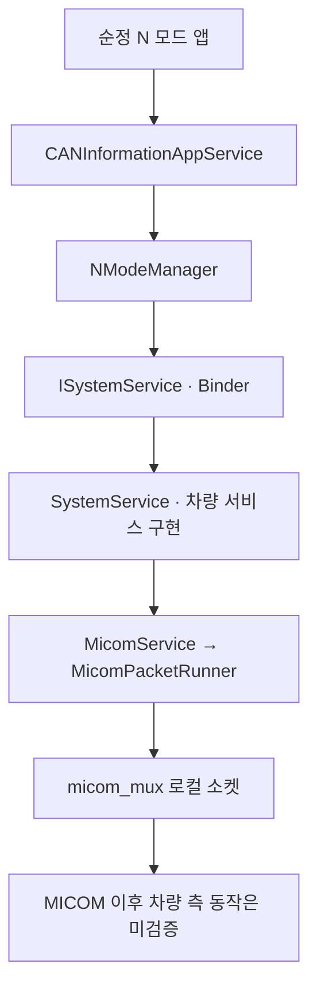

# CN7NPE KOR 260902 배기 제어 경로 분석

분석일: 2026-11-19. 대상 제품은 `CN7NPE.KOR.0000.V039.001.260902`, Android 4.4.2, TCC803x입니다.

**순정 배기음 단계 설정 경로는 확인했습니다. 플랩 강제 열림 / 닫힘 / 순정 자동 복귀 경로는 확인되지 않았습니다.** 아래 내용은 해당 펌웨어의 정적 분석 결과이며, 실차에 명령을 보내 동작을 검증한 결과가 아닙니다.

## 확인한 자료와 범위

N 모드 APK/ODEX, `automotive.odex`, 보완 추출한 `automotive-service.odex`의 관련 클래스들을 분석했습니다. 제조사 원본과 역컴파일 결과는 공개 저장소에 포함하지 않습니다.

보완 추출 v0.2.1의 실차 결과는 파일 두 개 복사, 오류 0, `result.txt`의 `collection=COMPLETE`, `progress.txt`의 100% COMPLETE였습니다. 이는 추출 완료이며 플랩 제어 성공을 의미하지 않습니다.

| 원본 ODEX | SHA-256 |
| --- | --- |
| automotive | `4fbf298012812a2f7dcc580267a571f3009c00dcc13ff485c79cffc87675ab56` |
| N 모드 앱 | `9f04812b1529be82c6c8ca2b1836d0ff8e03ec3342e4985d75abc084790306c4` |
| automotive-service | `745f78e516afdb9871753bf427ef3ba222ed634956dc40caa4406498389a7f8c` |

해당 ODEX의 관련 클래스는 API 17로 deodex·재조립한 뒤 분석했습니다. API 19 설정과 최적화 DEX의 직접 해석에서는 오류가 발생했습니다. 분석한 클래스의 deodex 로그와 재조립·JADX 처리는 정상 완료했으나 전체 헤드유닛 소프트웨어를 검증한 것은 아닙니다.

## 순정 설정 요청 경로

앱의 `PDCANValueMap`은 `BurnSound` 항목을 배기음 설정 항목 `ESND`로 매핑합니다. 이 항목의 값은 다음과 같습니다.

| 값 | 순정 앱에서의 의미 | 물리적 플랩 상태 판정 |
| --- | --- | --- |
| 0 | Normal | 미확인 |
| 1 | Sport | 미확인 |
| 3 | Sport+ | 미확인 |
| 2, 15 | 해당 배기음 값 변환에서는 INVALID | 자동 복귀로 사용할 근거 없음 |

`setIndividualDriveModeValue`는 `NModeManager.setIndividualDriveMode`로 위임하고, 서비스 구현은 항목과 설정값으로 이루어진 요청을 MICOM 전송 경로에 넘깁니다. Custom 2는 별도 요청인 `requestDriveCustomMode2`로 전달합니다. **이 경로가 존재한다는 사실만으로 플랩의 물리적 개폐를 강제할 수 있다고 결론 내릴 수 없습니다.**

전송은 `micom_mux`라는 로컬 소켓으로 향합니다. 확인한 내부 MICOM 기능 번호를 차량 CAN ID나 ECU 진단 명령으로 간주해서는 안 됩니다. 이 문서는 실행용 Binder/CAN 명령을 제공하지 않습니다.

## 상태 피드백과 자동 복귀의 한계

- `SystemService`는 MICOM의 주행모드 응답을 `DriveMode` 객체에 저장하고 리스너에 전달합니다. 배기음 설정 단계는 4비트 항목으로 해석되며, 항목 지원/상태 및 오류 비트도 별도로 들어옵니다.
- `getIndividualDriveMode()`는 보관 중인 `DriveMode` 객체를 반환합니다. getter 자체가 플랩 위치를 측정하거나 새 요청을 보내는 구현은 아닙니다. 값이 있다는 이유만으로 최신 물리 상태를 확인했다고 볼 수 없습니다.
- 현재 추적한 피드백에서 확인한 것은 주행모드 설정 단계입니다. 플랩 각도·액추에이터 위치·강제 제어 소유권을 나타내는 값으로 검증하지 못했습니다.
- **`resetIndividualDriveModeInstance()`는 자동 복귀 명령이 아닙니다.** 서비스 내부의 기본 데이터로 `DriveMode` 캐시를 초기화하며, 이 메서드 안에는 MICOM 전송이 없습니다. 이를 눌러 실제 차량이 순정 자동 제어로 돌아온다고 표시하면 잘못된 안내가 됩니다.
- Factory의 `responseRunSoundControl()`은 해당 진단 요청에 대한 ACK 경로이며, 이름만으로 배기 플랩 제어라고 볼 근거가 없습니다. Engineering의 N 모드 값 요청도 강제 개폐 API로 확인되지 않았습니다.

## 현재 판단과 필요한 다음 증거

헤드유닛의 순정 배기음 설정 전달 경로는 확인했습니다. 이 자료에서 요청된 세 가지 물리 제어와 그 해제를 증명하지 못했습니다. 이는 차량 전체에 그런 기능이 없다는 증명은 아닙니다.

다음 단계에는 MICOM/엔진 ECU/액추에이터 쪽의 **강제 개폐 명령과 제어 해제 규격** 또는 이미 강제 개폐가 확인된 진단 기록이 필요합니다. 함께 확인할 항목은 명령의 적용 조건, 실제 위치 피드백, 시간 만료·시동 전환·프로그램 종료 때의 동작, 원래 제어권으로 돌아가는 절차입니다.

순정 메뉴의 Normal/Sport/Sport+ 전환을 관찰하면 설정 경로의 실차 일치 여부는 확인할 수 있지만, 그 관찰만으로 강제 열림/닫힘/자동 제어를 입증할 수는 없습니다. 임의 값 대입이나 주행 중 시험으로 이 차이를 메우지 않습니다.

이 증거가 확보되기 전에는 동작하는 플랩 제어 패키지로 릴리스하지 않습니다. 기존 릴리스는 분석 자료 수집용으로 유지합니다.
